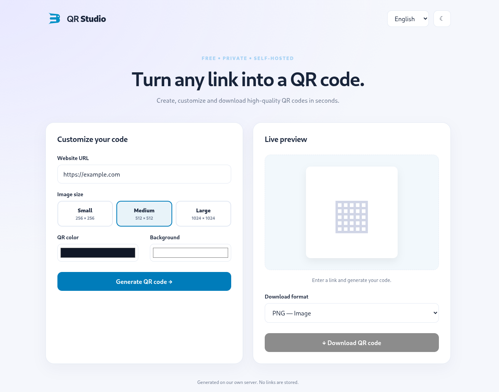
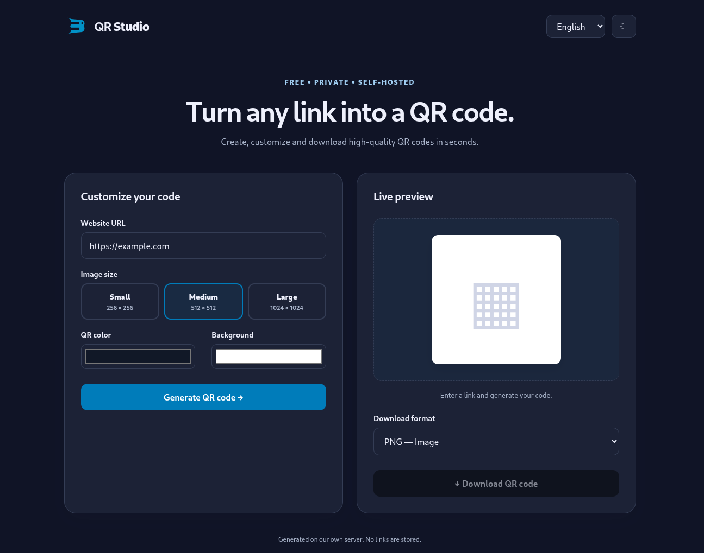

# Tritonia QR Studio

[](https://doi.org/10.5281/zenodo.23883677)

<table>
  <tr>
    <td width="50%" align="center"><strong>Light Mode</strong></td>
    <td width="50%" align="center"><strong>Dark Mode</strong></td>
  </tr>
  <tr>
    <td>
      
    </td>
    <td>
      
    </td>
  </tr>
</table>

Self-hosted QR code generator: PNG, JPEG, PDF, SVG; 256/512/1024 px; Finnish, Swedish, English; light/dark mode. No database, tracking or external QR API.

## Debian 13 / Apache installation

1. Install PHP dependencies and Composer:

   ```bash
   sudo apt update
   sudo apt install php-cli php-gd php-mbstring php-xml php-fpm composer unzip
   ```

2. Copy this directory to your Apache site, e.g. `/var/www/html/qrcode`. From that directory run:

   ```bash
   composer install --no-dev --optimize-autoloader
   ```

3. Point your existing Apache PHP-FPM-enabled virtual host or subdirectory at `index.php`. Ensure PHP-FPM is configured and active.

4. Restrict access to `vendor/` and `bootstrap.php` via Apache config (recommended), or place dependencies outside the web root. Example inside the site virtual host:

   ```apache
   <Directory /var/www/html/qrcode/vendor>
       Require all denied
   </Directory>
   <Files "bootstrap.php">
       Require all denied
   </Files>
   <Files "composer.json">
       Require all denied
   </Files>
   <Files "composer.lock">
       Require all denied
   </Files>
   ```

5. Use HTTPS. Verify generated QR codes with a phone before publishing.

## Notes

- Color controls work for PNG, SVG and PDF; JPEG always uses an opaque white backing.
- PDF output is an A4 page with a centered 150 mm QR image, independent of pixel-size selection.
- QR URLs are encoded as text; the server does not fetch them. No generated files are stored.
- This is a starter implementation. For an internet-facing deployment, add Apache or reverse-proxy rate limiting and consider request body limits.
- Avoid low-contrast color combinations: they may become unscannable.
- The `transparent` parameter is reserved for a future transparency feature and is not currently implemented.

## Citation

If you use Tritonia QR Studio in academic work, please cite:

https://doi.org/10.5281/zenodo.23883677

## License

Tritonia QR Studio is licensed under the Creative Commons Attribution 4.0 International (CC BY 4.0) license.

See the [LICENSE](LICENSE) file for the full license terms.

## Third-Party Dependencies

Third-party dependencies are installed separately using Composer and are subject to their respective licenses.

## AI Transparency

QR Studio has been developed with substantial assistance
from generative AI.

See [AI Transparency Statement](AI-TRANSPARENCY.md)
for details about AI contributions, human oversight,
testing, and accountability.
